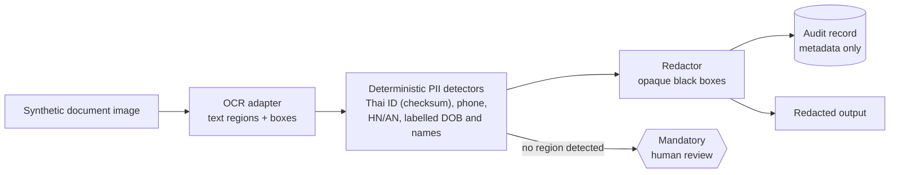

<div align="center">

# Thai Clinical PII Redactor

**Privacy-first redaction of personal data in synthetic Thai clinical documents.**

   

</div>

> Public documentation only. The implementation stays private during prototype hardening, and this is not a production medical system or a PDPA certification.

## Tech stack

<p align="center">
  
</p>

## Pipeline



---

> A clean-room, privacy-first prototype for redacting personally identifiable information from synthetic Thai clinical documents.

| | |
|---|---|
| **Status** | Prototype · active development |
| **Data policy** | Synthetic data only |
| **License** | MIT |
| **Implementation** | Private during prototype hardening |

## Repository scope

This public repository contains the product overview, high-level architecture, safety boundaries, and development roadmap.

The implementation is maintained in a private repository while the prototype is hardened. This separation prevents accidental publication of operational details and keeps the public claims aligned with what has been tested.

This project was independently rebuilt from scratch. It contains no employer source code, patient data, internal architecture, production configuration, or confidential evaluation material. It is not a production medical system or a PDPA certification.

## What it does

```text
synthetic document image
  → OCR text regions
  → deterministic PII detection
  → irreversible black-box redaction
  → metadata-only audit record
  → mandatory human review when no region is detected
```

The current prototype covers Thai national IDs with checksum validation, Thai phone numbers, HN/AN identifiers, labelled dates of birth, and explicitly labelled names.

## Public documents

- [Architecture](./ARCHITECTURE.md)
- [Safety and privacy boundaries](./SAFETY.md)
- [Roadmap](./ROADMAP.md)

## Disclosure

Please do not submit real patient documents to this prototype. For security or privacy concerns, contact the repository owner privately instead of opening an issue containing sensitive data.
